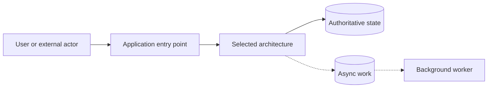

# ADR-XXX: [Decision title]

- **Status:** [Proposed / Accepted / Superseded]
- **Date:** [YYYY-MM-DD]
- **Decision scope:** [System or bounded scope]

## Context

Describe the requirements, actors, workflows, consistency-sensitive operations, external interactions, and constraints that motivate the decision. Clearly distinguish stated requirements from open questions.

## Decision

State the selected architecture and why it fits the documented scope.

### Responsibilities and boundaries

List the modules or components and their responsibilities. Identify the authoritative owner for critical state.

### Critical workflow behavior

Describe important flows such as reservations, payment, retries, expiry, authorization, or notifications without inventing unspecified technology or business values.

## Architecture comparison

| Decision factor | Selected architecture | Alternative 1 | Alternative 2 | Decision implication |
|---|---|---|---|---|
| [Factor] | [Assessment] | [Assessment] | [Assessment] | [Why it matters] |

## Architectural overview

Solid arrows represent the main request or state path. Dashed arrows represent asynchronous work. Replace the placeholders with the actual logical components and flows.

## Consequences

### Benefits

- [Benefit]

### Costs and risks

- [Cost or risk]

### Low-level implementation pain points

| Pain point | Failure or race scenario | Required design response |
|---|---|---|
| [Concurrency/retry/failure concern] | [What can go wrong] | [Architectural response] |

## Alternatives considered

### [Alternative 1]

Describe the architecture, why it is viable, and why it was not selected.

### [Alternative 2]

Describe the architecture, why it is viable, and why it was not selected.

## Deliberately unresolved decisions

- [Missing requirement or business decision]

## Review and migration triggers

Reconsider this ADR if:

- [Measured constraint or newly confirmed requirement]
