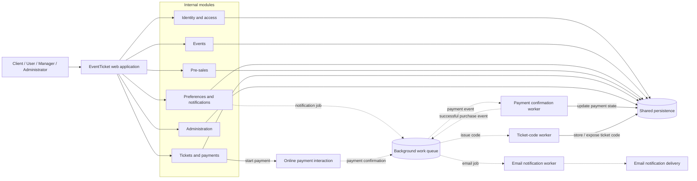

# ADR-001: Choose a Modular Monolith for EventTicket

- **Status:** Accepted as the starting architecture
- **Date:** 2026-10-29
- **Decision scope:** The web application described in `data/EventTicket.txt`

## Context

EventTicket is a web application for discovering events, proposing and managing events, booking pre-sales, buying tickets online, and obtaining ticket codes. The user stories define four role levels:

- **Client:** visit the application, register, log in, explore events, and recover a forgotten password.
- **User:** manage personal data, favourite categories, related email notifications, pre-sale bookings, bought tickets, online payments, ticket codes, and logout.
- **Manager:** view proposed events, insert a new event, manage personal data, and logout.
- **Administrator:** add managers, manage personal data, and logout.

Task 1 considered three possible architectures: a modular monolith, microservices, and a serverless event-driven architecture. The requirements do not state traffic targets, availability targets, ticket capacity rules, payment-provider details, or the duration of a possible ticket hold.

The ticket-purchase discussion identified a concurrency concern: if a ticket must be unavailable while one user is completing payment, two users must not claim it simultaneously. This requires an authoritative ticket or availability record and an atomic claim operation. A possible hold can have an expiry timestamp, but the hold duration and related business rules are not specified.

## Decision

We will start with a **modular monolith**: one deployable web application with explicit internal modules and shared persistence.

The initial module boundaries are:

1. **Identity and access**
   - Registration, login, logout, roles, and password regeneration.
   - Server-side enforcement for client, user, manager, and administrator behavior.
2. **Events**
   - Event discovery.
   - Manager event proposals and the list of events proposed by a manager.
3. **User preferences and notifications**
   - Personal data and favourite categories.
   - Email notifications about events related to favourite categories.
4. **Pre-sales**
   - Pre-sale booking and the user's booked pre-sales.
5. **Tickets and payments**
   - Ticket purchase, online payment state, bought tickets, and ticket-code availability.
   - If temporary holds are adopted, this module owns the authoritative ticket/availability state.
6. **Administration**
   - Administrator operations for adding managers and viewing administrator data.

The modules should communicate through explicit internal interfaces even though they initially run in one application. The shared persistence boundary should be used deliberately rather than allowing unrestricted cross-module access.

For a ticket purchase that uses a temporary hold, the ticket module should atomically:

1. verify that the ticket or availability record is available, or that a previous hold has expired;
2. claim it for the current purchase attempt;
3. record an expiry timestamp;
4. prevent competing active claims;
5. change the hold to purchased after successful payment; or
6. release it after failed or abandoned payment.

The exact hold duration, whether holds apply to pre-sales, and interrupted-payment behavior are intentionally not decided by this ADR because they are absent from the requirements.

Email notifications and payment-related work should be represented with explicit intermediate and failure states. Slow or retryable work should not unnecessarily block the main user request. No particular background mechanism is selected here.

## Architecture comparison

| Decision factor | Modular monolith | Microservices | Serverless event-driven | Decision |
|---|---|---|---|---|
| Consistency for ticket holds and payment state | Simplest: internal modules can use one transaction boundary | Distributed workflow; requires idempotency and recovery coordination | Distributed workflow; retries and delayed events require idempotency | Prefer modular monolith |
| Operational complexity | One deployable application and shared persistence | Multiple services, APIs, deployment and observability concerns | Functions, event delivery, retries, and workflow tracing | Prefer modular monolith |
| Scaling model | Scale the application and persistence together initially | Scale capabilities independently | Elastic function execution and asynchronous processing | No stated target requires the added complexity |
| Notifications and slow work | Can be isolated behind background handling inside the application | Can be isolated as a service | Naturally handled through events or queues | Keep the behavior explicit; technology remains open |
| High-traffic suitability | Can be scaled first; shared bottlenecks remain visible | Useful if independent scaling is demonstrated necessary | Useful for irregular bursts if workflow complexity is justified | Reassess only with measured requirements |
| Fit for documented scope | Strongest starting fit | More complex than necessary initially | More complex than necessary initially | Select modular monolith |

### Architectural trade-off matrix

| Trade-off | Modular monolith decision | Effect on EventTicket |
|---|---|---|
| Simplicity versus independent scaling | Accept shared deployment initially | Fewer operational parts, but the runtime and persistence are shared bottlenecks. |
| Transactional consistency versus service isolation | Keep ticket/payment coordination inside one application boundary | Easier prevention of double claims, but less independent deployment. |
| Synchronous response versus background processing | Keep user-facing commands direct; move email and payment follow-up to background work | Requests remain responsive, but state transitions and retries must be observable. |
| Immediate availability versus temporary reservation safety | Use an atomic ticket claim if temporary holds are adopted | Prevents competing buyers from claiming the same ticket, but introduces expiry and recovery rules. |
| Current scope versus future scale | Delay extraction until measured needs exist | Avoids premature complexity while retaining explicit module boundaries for later migration. |

## Architectural overview

Solid arrows represent the main request and state path. Dashed arrows represent asynchronous background work that is decoupled from the originating request. The diagram shows logical responsibilities, not specific products or deployment technology. The payment and email elements are external interaction boundaries; the requirements do not specify their providers or protocols.

## Consequences

### Benefits

- User stories can be implemented with direct request/response flows and without network calls between internal modules.
- Shared persistence and a single transaction boundary make role checks, event ownership, ticket state, payment state, and ticket-code state easier to coordinate.
- One deployable application is simpler to test, operate, monitor, and deploy than multiple services.
- Explicit module boundaries retain a possible future path to extract a capability if later evidence justifies it.
- The ticket module can enforce the critical no-double-claim rule without distributed transactions.

### Costs and risks

- The application remains one deployment unit, so a failure or problematic change can affect multiple modules.
- Shared persistence can create coupling if modules access each other's data directly.
- The shared database and single runtime may become scaling bottlenecks.
- Email and payment interactions can be slow or unavailable and require explicit retry, failure, and intermediate-state handling.
- Ticket buying and pre-sale booking need concurrency protection; simply adding application instances does not by itself prevent conflicting claims.
- A temporary hold introduces expiry and recovery behavior that must be specified and tested.
- The architecture does not automatically solve high-traffic requirements. No such requirement is stated, so the ADR does not prescribe premature service separation.

### Low-level implementation pain points

| Pain point | Failure or race scenario | Required design response |
|---|---|---|
| Concurrent ticket holds | Two purchase requests observe the same ticket as available and both attempt to claim it. | Make the availability check and claim one atomic operation owned by the ticket module; reject a second active claim. |
| Hold expiry race | A payment request arrives near expiry while cleanup or another purchase request is also processing the hold. | Check the expiry during every claim or payment transition, and make the state transition conditional; do not rely only on a delayed cleanup task. |
| Duplicate payment confirmation | A payment confirmation or background message is delivered more than once. | Store an idempotency key or equivalent purchase identity and make repeated confirmations harmless. |
| Ticket-code issuance retry | A worker fails after payment succeeds and retries code creation. | Make code creation and persistence idempotent so retries do not create conflicting codes or duplicate ticket records. |
| Abandoned or failed payment | A user holds a ticket but never completes payment, or payment fails after the hold is created. | Represent intermediate and failed states explicitly and release the hold according to the eventual hold policy. |
| Notification delay or failure | Email delivery is slow or unavailable while a user changes a favourite category or an event is handled. | Decouple email work through background processing and retain retryable notification state without blocking the main request. |

These are implementation concerns, not newly specified business rules. The source requirements still need to define the hold duration, pre-sale applicability, and interrupted-payment behavior.

## Alternatives considered

### Microservices

Separate services could be created for identity, events, preferences/notifications, pre-sales or reservations, tickets/payments, and administration.

**Why not selected initially:** service boundaries and independent scaling are attractive, but a purchase can cross service boundaries and introduce distributed consistency problems. Ticket holds, payment completion, and ticket-code issuance would need idempotent commands and a recovery workflow rather than one shared transaction. The requirements provide no traffic or availability target that justifies this operational complexity.

Microservices may be reconsidered if measured load, availability needs, or independent ownership make service isolation necessary. High event-browsing traffic alone would not remove the need for an authoritative, serialized ticket claim.

### Serverless event-driven architecture

HTTP/API entry points and short-lived functions could use persistent state and events or queues for notifications, payment follow-up, ticket-code issuance, and expired-hold processing.

**Why not selected initially:** this could absorb bursts and decouple slow workflows, but retries and duplicate delivery require idempotent state transitions. Expiry events can be delayed, so ticket purchase attempts must still check the hold timestamp. Workflow tracing, delayed data, and distributed state coordination add complexity that is not required by the documented scope.

This alternative may be reconsidered for irregular bursts or when asynchronous workflow isolation becomes a demonstrated need.

## Requirements and decisions deliberately left open

The following are not specified by the source requirements and therefore are not invented by this ADR:

- exact ticket capacity and availability model;
- whether every ticket or only an availability record is held;
- temporary-hold duration;
- whether pre-sales use the same hold mechanism;
- behavior after an interrupted or failed payment;
- payment provider and integration protocol;
- email provider and background-processing technology;
- traffic, latency, availability, or scaling targets;
- programming language, database product, hosting environment, and deployment tooling.

These items require product or implementation decisions before detailed design.

## Review and migration triggers

Review this decision if evidence shows that:

- the single runtime or shared persistence cannot meet an explicitly defined target;
- event discovery, notifications, or ticket/payment work requires independent scaling;
- operational ownership requires independently deployable capabilities;
- asynchronous workflow requirements justify the additional event-driven coordination.

Any later extraction should preserve the ticket/availability ownership and idempotent purchase semantics established here.
